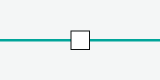

# SOSIE_211_D401-1_3 — Traction

## 5 Schématique de traction <!-- § 5 -->

La schématique de traction occupe la partie basse de la vue synoptique principale. Elle représente les sous-stations, les disjoncteurs et les sectionneurs de la ligne.

<!-- req EXI_MOP_SPF_510_A_20 -->
EXI_MOP_SPF_510_A_20 : Le TCO à deux rangs affiche la schématique du trafic sur le rang haut et la schématique de traction sur le rang bas.

### 5.6 Objets de traction <!-- § 5.6 -->

Chaque objet de traction est représenté par un symbole dont la couleur traduit son état.

#### 5.6.6 Sectionneur (S) <!-- § 5.6.6 -->

<!-- req EXI_MOP_SPF_511_A_1650 -->
EXI_MOP_SPF_511_A_1650 : Le sectionneur est représenté sur la schématique de traction par le symbole de la Figure 40.

 <!-- fig 40 -->

<!-- req EXI_MOP_SPF_511_A_1660 -->
EXI_MOP_SPF_511_A_1660 : L'état ouvert ou fermé du sectionneur est visible sans ouvrir de fenêtre.

Selon le type de sectionneur, le menu contextuel diffère. Un sectionneur sans télécommande (TK) propose les commandes d'autorisation et de confirmation ; un sectionneur avec TK manœuvré régulièrement ne propose que Propriétés.

<!-- req EXI_MOP_SPF_511_A_1670 -->
EXI_MOP_SPF_511_A_1670 : Le menu contextuel d'un sectionneur sans TK propose : Propriétés, Autoriser l'ouverture, Annuler l'autorisation d'ouverture, Confirmer l'ouverture, Autoriser la fermeture, Annuler l'autorisation de fermeture, Confirmer la fermeture.

<!-- req EXI_MOP_SPF_511_A_1680 -->
EXI_MOP_SPF_511_A_1680 : La fenêtre Propriétés affiche l'état de la position, les heures de la dernière autorisation et confirmation d'ouverture et de fermeture, et les points kilométriques voie 1 et voie 2.

#### 5.6.7 Disjoncteur (D) <!-- § 5.6.7 -->

Le disjoncteur est commandé à distance depuis le PCC. Son menu contextuel propose Ouvrir, Fermer et Propriétés.
