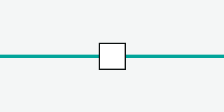

## Description

Vérifie le menu contextuel et la fenêtre Propriétés d'un sectionneur sans télécommande (TK) sur la vue de traction. Technique boîte noire : partition par type de sectionneur.

## Step 1 <!-- 101 -->

### Action

Ouvrir la vue de traction de la ligne 92 et repérer le sectionneur S 12.

### Expected Result

Le sectionneur S 12 est affiché sur la schématique de traction avec le symbole du sectionneur.

### Exigence

EXI_MOP_SPF_511_A_1650

### Sources

- SOSIE_211_D401-1_3#§5.6.6 "Le sectionneur est représenté sur la schématique de traction par le symbole de la Figure 40"
- SOSIE_211_D401-1_3#fig:40 "Figure 40 – Représentation graphique sectionneur"

### Attachments

- images/fig-40.png <!-- 9001 -->

## Step 2 <!-- 102 -->

### Action

Clic droit sur le sectionneur S 12 de la vue de traction.

### Expected Result

Le menu propose : Propriétés, Autoriser l'ouverture, Annuler l'autorisation d'ouverture, Confirmer l'ouverture, Autoriser la fermeture, Annuler l'autorisation de fermeture, Confirmer la fermeture.

### Exigence

EXI_MOP_SPF_511_A_1670, EXI_MOP_SPF_510_A_20

### Sources

- SOSIE_211_D401-1_3#§5.6.6 "Selon le type de sectionneur, le menu contextuel diffère"
- SOSIE_211_D401-1_3#§5.6.6 "Le menu contextuel d'un sectionneur sans TK propose"

## Step 3 <!-- 103 -->

### Action

Choisir Propriétés.

### Data

Sectionneur S 12, position fermée.

### Expected Result

Une fenêtre affiche l'état de la position, les heures de la dernière autorisation et confirmation d'ouverture et de fermeture, et les points kilométriques voie 1 et voie 2.

||Champ||Valeur attendue||
|Position|Fermé|
|PK voie 1|12,480|

### Exigence

EXI_MOP_SPF_511_A_1680

### Sources

- SOSIE_211_D401-1_3#§5.6.6 "La fenêtre Propriétés affiche l'état de la position"

## Step 4 <!-- 104 -->

### Action

Choisir Autoriser l'ouverture puis Confirmer l'ouverture.

### Expected Result

Le symbole du sectionneur S 12 passe à l'état ouvert sans ouvrir de fenêtre.

### Exigence

EXI_MOP_SPF_511_A_1660

### Sources

- SOSIE_211_D401-1_3#§5.6.6 "L'état ouvert ou fermé du sectionneur est visible sans ouvrir de fenêtre"

## Step 5 <!-- 105 -->

### Action

Faire circuler un train sur la section du sectionneur ouvert.

### Expected Result

La traction n'est pas simulée : le train garde sa vitesse.

### Exigence

EXI_MOP_SPF_511_A_1660
